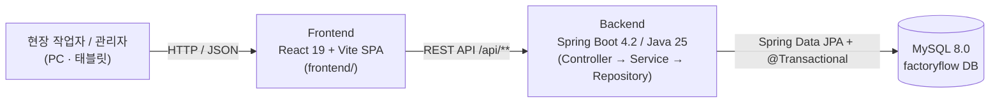
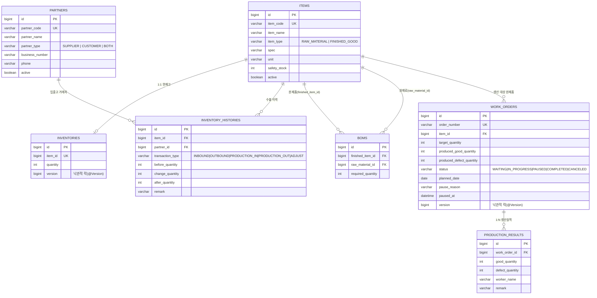

# FactoryFlow — 골판지 상자 제조 현장용 Mini MES

> **수기·엑셀 위주로 관리하던 소규모 골판지 제조 현장의 기준정보, BOM, 작업지시, 생산실적, 재고 수불을 하나의 웹 시스템으로 통합한 풀스택 Mini MES(제조실행시스템)**


---

## 1. 프로젝트 기획 배경

소규모 골판지 상자 제조업체는 여전히 종이 작업지시서와 수기 엑셀에 의존해 다음과 같은 현장 문제를 겪습니다.

- 생산이 끝난 뒤 원단(원지) 차감과 완제품 입고를 따로 적어 **전산 재고와 실물 재고 간 오차**가 누적됨
- 작업 중 원단 부족·설비 점검 같은 돌발 이벤트가 생겼을 때 **정지 사유와 진행 현황이 실시간 공유되지 않음**
- 안전재고 미만 품목 파악이 늦어 **긴급 납기 지연**으로 이어짐

**FactoryFlow**는 과도한 엔터프라이즈 복잡성 대신 **단일 트랜잭션 기반의 정확한 재고 정합성**과 **현장 작업자 친화적 UI/UX**에 집중해 설계했습니다.

---

## 2. 기술 스택

| 영역 | 기술 | 선정 이유 |
| --- | --- | --- |
| **Backend** | Java 25 (Temurin LTS), Spring Boot 4.2.0, Spring Data JPA, Spring Validation, Lombok, Gradle 9.9.2 | 계층 분리(`Controller → Service → Repository`)와 트랜잭션 기반 도메인 모델링 |
| **Database** | MySQL 8.0 | 재고·생산실적의 ACID 트랜잭션과 외래키/유니크 제약 보장 |
| **Frontend** | React 19, Vite 6, React Router 7 | 백엔드와 완전히 분리된 SPA 구조, 빠른 HMR 및 경량 번들링 |
| **Test** | JUnit 5, Mockito, Spring MockMvc, `@SpringBootTest` | 도메인 핵심 규칙·예외 처리·API 계약을 자동화 테스트(55건)로 검증 |
| **Packaging** | Multi-stage `Dockerfile` (Temurin 25 JDK/JRE), `vercel.json`, `application-prod.properties` | 클라우드 분리 배포(Vercel + Render/Railway + MySQL) 즉시 대응 |

---

## 3. 시스템 아키텍처 & ERD

### 시스템 아키텍처


### 데이터베이스 ERD (7개 핵심 테이블)


---

## 4. 핵심 기능

### 1) 실시간 관제 대시보드 (`DashboardPage`)
- **이상 징후 경고 배너**: 안전재고 미만 품목 수와 일시정지(`PAUSED`) 작업지시 건수를 최상단에 즉시 강조하고 해당 화면으로 바로 이동 링크 제공
- **KPI 카드 & 30초 자동 갱신**: 금일 양품·불량 수량, 불량률, 진행 중/일시정지 작업 건수, 안전재고 미만 품목 집계
- **사이드바 실시간 알림 배지**: 재고 관리(안전재고 미만, 빨간 배지) 및 작업지시(일시정지 건수, 주황 배지) 실시간 동기화

### 2) BOM 기반 생산실적 ↔ 재고 자동 연동 (`ProductionService`)
- 작업지시에 생산실적(양품 + 불량)을 등록하면 **하나의 `@Transactional` 안에서** 아래 처리가 원자적으로 수행됩니다.
  1. 등록된 BOM 기준으로 `(양품 + 불량) × 소요수량`만큼 원재료 재고 자동 차감 (`PRODUCTION_OUT` 이력 기록)
  2. 양품 수량만큼 완제품 재고 자동 증가 (`PRODUCTION_IN` 이력 기록)
  3. 원재료 재고가 부족하면 전체 트랜잭션 롤백 (음수 재고 원천 차단)
  4. 누적 양품이 목표 수량에 도달하면 작업지시 자동 `COMPLETED` 전환
- 프론트엔드에서는 **실적 입력 시 BOM 예상 원재료 소모량과 부족 여부를 실시간 미리보기**하고, 확인 모달을 거쳐 오입력을 방지합니다.

### 3) 현장 이벤트 대응 — 작업지시 일시정지(`PAUSED`) & 재개
- 진행 중(`IN_PROGRESS`)인 작업에서 원단 부족·설비 점검 등이 발생하면 **원터치 5종 사유 칩** 또는 직접 입력으로 즉시 일시정지
- `PAUSED` 상태에서는 **서버([`WorkOrder.recordProduction`](src/main/java/com/lgb/factoryflow/domain/production/entity/WorkOrder.java))와 UI 양쪽에서 생산실적 등록을 차단**해 정지 중 오입력 방지
- 대시보드 진행 현황 테이블 최상단에 일시정지 작업과 정지 사유·시각을 우선 노출하며, 확인 모달을 통해 안전하게 재개

### 4) 현장 작업 환경 맞춤 UI/UX
- **현장 터치 모드**: 장갑 착용·태블릿 환경을 고려한 대형 버튼/고대비 모드 토글
- **날짜별 생산실적 이력**: 기간 필터(`전체 / 오늘 / 최근 7일 / 날짜 지정`), 키워드 검색, 정렬, 날짜별 접이식(Collapsible) 그룹화 및 일별 양품/불량 소계 요약
- **오조작 방지 피드백**: 상태 변경·출고·실적 등록 등 영향력이 큰 액션에 `ConfirmModal` 및 `Toast` 알림 적용

---

## 5. 화면 미리보기

> 로컬에서 `docs/sample-data.sql`을 적재한 뒤 캡처 이미지를 `docs/images/`에 추가하면 포트폴리오 미리보기가 완성됩니다.

| 화면 | 핵심 확인 포인트 |
| --- | --- |
| **대시보드** | 상단 이상 징후 배너(안전재고 미만 + 일시정지), KPI 4종, 진행 중/일시정지 작업 현황 |
| **작업지시 · 실적** | `PAUSED` 행 강조·일시정지 사유 모달, BOM 소모량 미리보기, 날짜별 생산실적 그룹 |
| **재고 · 수불 이력** | 안전재고 미만 하이라이트, 입고/출고/실사조정, 거래처별 수불 이력 추적 |
| **기준정보 · BOM** | 원재료/완제품 품목 관리, 매입처/납품처 관리, 완제품별 원재료 BOM 구성 |

---

## 6. 주요 REST API 명세

모든 응답은 공통 형식 `ApiResponse<T>` (`{ success, message, data }`)로 통일되어 있습니다.

| 도메인 | 메서드 | 엔드포인트 | 설명 |
| --- | :---: | --- | --- |
| **Health** | `GET` | `/api/health` | 서버 상태 확인 |
| **Dashboard** | `GET` | `/api/dashboard?date=YYYY-MM-DD` | 일일 생산량·불량률·일시정지/진행중 작업·안전재고 미만 요약 |
| **Item** | `GET/POST/PUT/PATCH` | `/api/items`, `/api/items/{id}`, `/api/items/{id}/status` | 품목(원재료/완제품) CRUD 및 활성/비활성 전환 |
| **Partner** | `GET/POST/PUT/PATCH` | `/api/partners`, `/api/partners/{id}`, `/api/partners/{id}/status` | 거래처(매입처/납품처/겸용) CRUD |
| **BOM** | `GET/POST/PUT/DELETE` | `/api/boms`, `/api/boms/{id}` | 완제품별 원재료 소요량 관리 |
| **Inventory** | `GET/POST` | `/api/inventories`, `/inbound`, `/outbound`, `/adjust`, `/histories` | 현재고 조회, 입출고·실사조정 및 수불 이력 |
| **Production** | `GET/POST/PATCH` | `/api/work-orders`, `/{id}/status`, `/{id}/results`, `/api/production-results` | 작업지시 생성, 상태 변경(`PAUSED` 사유 포함), 생산실적 등록·조회 |

---

## 7. 트러블슈팅 & 기술적 의사결정

### ① Hibernate MySQL `ENUM` 컬럼과 신규 상태(`PAUSED`) 추가 시 `Data truncated` 오류
- **문제**: `WorkOrderStatus`에 `PAUSED`를 추가한 뒤 통합 테스트 실행 시 `Data truncated for column 'status'` 예외 발생.
- **원인**: Hibernate가 `@Enumerated(EnumType.STRING)` 필드를 MySQL `ENUM(...)`으로 생성했고, `ddl-auto=update`는 기존 `ENUM` 목록을 자동 확장하지 않음.
- **해결**: [`WorkOrder.status`](src/main/java/com/lgb/factoryflow/domain/production/entity/WorkOrder.java)에 `columnDefinition = "varchar(30)"`을 명시하고 기존 테이블을 비파괴 `ALTER TABLE ... MODIFY COLUMN status VARCHAR(30) NOT NULL`로 마이그레이션해 향후 상태 확장에도 안전하도록 개선.

### ② Spring Boot 4에서 미존재 경로(`/`) 요청 시 `500 Internal Server Error` 반환 문제
- **문제**: 백엔드 루트(`/`) 등 등록되지 않은 경로 접근 시 404가 아닌 `500` 응답 발생.
- **원인**: Spring Boot 4에서 발생하는 `NoResourceFoundException`이 전역 `@ExceptionHandler(Exception.class)`로 폴백됨.
- **해결**: [`GlobalExceptionHandler`](src/main/java/com/lgb/factoryflow/global/exception/GlobalExceptionHandler.java)에 `NoResourceFoundException`(404)과 `HttpRequestMethodNotSupportedException`(405) 전용 핸들러를 추가하고 [`HealthControllerTest`](src/test/java/com/lgb/factoryflow/global/HealthControllerTest.java)로 회귀 검증.

### ③ 재고 정합성 및 커넥션 점유 최소화 설계
- `Inventory`와 `WorkOrder`에 `@Version`(낙관적 락)을 적용해 동시 수정 시 덮어쓰기 방지.
- `spring.jpa.open-in-view=false`(OSIV 비활성화)를 기본 적용하고, 조회 서비스는 `@Transactional(readOnly = true)`, 상태 변경 서비스는 `@Transactional`로 명확히 분리.
- 재고 수량 변경은 반드시 `InventoryHistory` 이력 저장과 같은 트랜잭션으로 묶어 감사 추적성 확보.

### ④ 클라우드 배포 환경 대응 설계
- 해외 리전 컨테이너의 UTC 시간대로 인해 일일 생산 집계(`LocalDate.now()`)가 어긋나는 문제를 방지하기 위해 `Dockerfile`에 `-Duser.timezone=Asia/Seoul` 고정.
- CORS 허용 도메인(`CORS_ALLOWED_ORIGINS`)과 포트(`PORT`)를 환경변수로 외부화하고 [`WebConfigCorsTest`](src/test/java/com/lgb/factoryflow/global/config/WebConfigCorsTest.java)로 검증.

---

## 8. 자동화 테스트 현황

`./gradlew test` 기준 **총 17개 테스트 스위트 / 55개 테스트 전부 통과** (실패 0, 오류 0)

- **도메인 단위 테스트**: `WorkOrderTest` (일시정지/재개 규칙·사유 누락·정지 중 실적 차단)
- **서비스 단위 테스트**: `ItemServiceTest`, `PartnerServiceTest`, `BomServiceTest`, `InventoryServiceTest`, `ProductionServiceTest`, `DashboardServiceTest`
- **웹/CORS 슬라이스 테스트**: `HealthControllerTest`, `WebConfigCorsTest`, 각 도메인 `*ControllerTest`
- **통합 테스트 (`@SpringBootTest`)**: `ItemIntegrationTest`, `InventoryIntegrationTest`, `ProductionIntegrationTest`, `DashboardIntegrationTest`

---

## 9. 로컬 실행 및 시연 데이터 적용 방법

### 사전 요구사항
- Java 25 (Temurin LTS), Node.js 20+ (권장 26), MySQL 8.0

### 1) MySQL 데이터베이스 및 계정 생성
[`docs/database-setup.sql`](docs/database-setup.sql)을 참고해 `factoryflow` DB와 전용 계정을 생성합니다.

### 2) 로컬 설정 파일 준비 및 환경변수 등록
`src/main/resources/application-local.example.properties`를 복사해 `application-local.properties`를 만들고(`.gitignore` 보호), 터미널에 DB 환경변수를 등록합니다.

```powershell
$env:DB_USERNAME="factoryflow_user"
$env:DB_PASSWORD="your-password"
```

### 3) 백엔드 · 프론트엔드 실행
```powershell
# 터미널 1: Spring Boot 백엔드 (http://localhost:8080)
.\gradlew.bat bootRun

# 터미널 2: React(Vite) 프론트엔드 (http://localhost:5173)
cd frontend
npm install
npm run dev
```

### 4) 시연용 샘플 데이터 적재 (선택)
백엔드를 1회 실행해 테이블이 생성된 뒤, 골판지 공장 시나리오 데이터를 한 번에 적재할 수 있습니다.

```powershell
# Windows PowerShell
Get-Content docs/sample-data.sql -Raw -Encoding UTF8 | mysql -u factoryflow_user -p --default-character-set=utf8mb4 factoryflow
```

> 적재 후 `http://localhost:5173`에 접속하면 **안전재고 미만 경고 3건, 일시정지 작업지시 2건, 5대 상태 작업지시 8건, 4개 날짜 분산 생산실적 10건, 5대 유형 수불 이력 12건, 다중 BOM 9건**을 즉시 확인할 수 있습니다.

---

## 10. 프로젝트 구조 & 설계 문서

```text
factoryflow/
├─ src/main/java/com/lgb/factoryflow/
│  ├─ global/          # 공통 응답(ApiResponse), 예외 처리, 동적 CORS, BaseTimeEntity, Health API
│  └─ domain/          # item, partner, bom, inventory, production, dashboard (계층 분리)
├─ src/test/           # 단위·슬라이스·통합 테스트 (17 스위트 / 55건)
├─ frontend/           # React(Vite) SPA (6개 화면 + 공통 UI 컴포넌트 + vercel.json)
├─ docs/
│  ├─ project-overview.md       # 프로젝트 개요 및 아키텍처
│  ├─ requirements.md           # 기능·비기능 요구사항 명세
│  ├─ development-roadmap.md    # Phase 1~6 개발 로드맵
│  ├─ database-setup.sql        # MySQL 초기 DB·계정 생성 스크립트
│  ├─ sample-data.sql           # 포트폴리오 시연용 골판지 공장 샘플 데이터
│  └─ deployment-guide.md       # 클라우드 배포 가이드 (Vercel + Render/Railway + MySQL)
├─ Dockerfile          # Java 25 멀티 스테이지 프로덕션 이미지
└─ AGENTS.md           # 개발 가이드 및 안전 규칙
```
